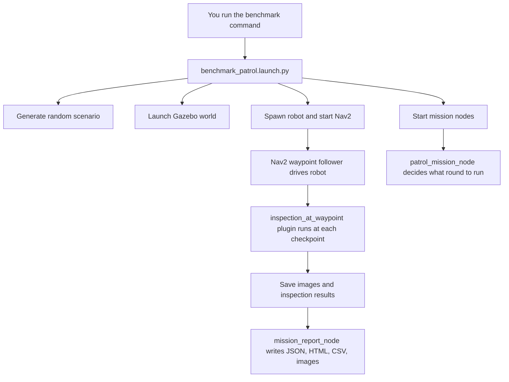

# Pipeline Workflow For Beginners

This guide explains the current robot pipeline in simple words.

Think of this project like a school team doing a factory check:

- one student builds the test area
- one student brings the robot into the area
- one student tells the robot where to go
- one student checks what the robot saw
- one student writes the final report

In code, those "students" are different launch files, nodes, and plugins.

## 1. What This Project Does In One Sentence

This project launches a robot in a simulated warehouse, sends it to factory checkpoints, inspects what it sees, and saves reports and images about what it found.

## 2. The Exact Command We Tested Today

Verified on **July 17, 2026** with this command:

```bash
cd /home/samarth/projects/industrial-robot-operations-intelligence
source /opt/ros/jazzy/setup.bash
source /home/samarth/projects/industrial-robot-operations-intelligence/install/setup.bash
./tools/clean_benchmark_runtime.sh
./tools/run_iteration_smoke_test.sh
```

This passed successfully in the log:

[`benchmark_attempt_20260717_200311_1.log`](/home/samarth/.ros/factory_inspection/benchmark/retry_logs/benchmark_attempt_20260717_200311_1.log)

## 3. What A Successful Run Looked Like

These are real log lines from the passing test:

```text
Managed nodes are active
Nav2 accepted patrol round 1.
Round 1 heading to checkpoint 1/10: spawn_lane
Inspection saved at checkpoint spawn_lane ... label=roller_imbalance severity=warning
Round 1 heading to checkpoint 2/10: east_aisle
Inspection saved at checkpoint east_aisle ... label=unconfirmed_visual_finding
Round 1 heading to checkpoint 3/10: upper_right_turn
Inspection saved at checkpoint upper_right_turn ... label=gas_leak_detected severity=critical
Round 1 heading to checkpoint 6/10: mid_east_service_bay
```

What this means in simple English:

- Nav2 woke up correctly
- the mission node successfully handed Nav2 a patrol job
- the robot started moving checkpoint to checkpoint
- the inspection plugin saved evidence while the patrol was happening

## 4. Big Picture Map

### Simple ASCII Map

```text
You run command
    |
    v
benchmark_patrol.launch.py
    |
    +--> benchmark_scenario_generator.py
    |      builds today's world + checkpoints + anomaly setup
    |
    +--> benchmark_world.launch.py
    |      starts Gazebo world
    |
    +--> benchmark_robot_instance.launch.py
    |      spawns robot + bridges sensors + starts Nav2
    |
    +--> patrol_mission.launch.py
           |
           +--> patrol_mission_node
           |      sends waypoint patrol rounds
           |
           +--> mission_report_node
                  writes reports and dashboard

While Nav2 is driving:
waypoint_follower -> inspection_at_waypoint plugin
                  -> captures image
                  -> classifies finding
                  -> saves image + markers + inspection result
```

### Mermaid Flowchart



## 5. Where The Code Actually Starts

If you want the true starting point, start here:

[`benchmark_patrol.launch.py`](/home/samarth/projects/industrial-robot-operations-intelligence/src/factory_inspection_mission/launch/benchmark_patrol.launch.py)

Why this file matters:

- it is the main single-robot benchmark entry point
- it builds the scenario
- it launches the world
- it launches the robot
- it launches the mission layer

Most important code spots:

- `launch_setup(...)` at [`benchmark_patrol.launch.py:29`](/home/samarth/projects/industrial-robot-operations-intelligence/src/factory_inspection_mission/launch/benchmark_patrol.launch.py#L29)
- main launch description at [`benchmark_patrol.launch.py:227`](/home/samarth/projects/industrial-robot-operations-intelligence/src/factory_inspection_mission/launch/benchmark_patrol.launch.py#L227)

## 6. The Full Story Of What Happens After You Press Run

### Step 1: The benchmark launcher wakes up

File:
[`benchmark_patrol.launch.py`](/home/samarth/projects/industrial-robot-operations-intelligence/src/factory_inspection_mission/launch/benchmark_patrol.launch.py)

What it does:

- clears dangerous graphics environment variables
- reads launch options like `headless`, `use_rviz`, and `robot_profile`
- decides where artifacts will be saved

Important lines:

- unsets risky GL vars at [`benchmark_patrol.launch.py:239`](/home/samarth/projects/industrial-robot-operations-intelligence/src/factory_inspection_mission/launch/benchmark_patrol.launch.py#L239)
- declares main launch arguments at [`benchmark_patrol.launch.py:241`](/home/samarth/projects/industrial-robot-operations-intelligence/src/factory_inspection_mission/launch/benchmark_patrol.launch.py#L241)

### Step 2: The scenario is generated

File:
[`benchmark_scenario_generator.py`](/home/samarth/projects/industrial-robot-operations-intelligence/src/factory_inspection_mission/launch/benchmark_scenario_generator.py)

What it does:

- builds the world for this run
- creates the checkpoint list
- chooses which assets are nominal or anomalous
- writes files into `~/.ros/factory_inspection/benchmark/scenario/`

Analogy:

This is like a teacher setting up an exam hall before students walk in.

Why it exists:

- so each run can be reproducible
- so the patrol route and anomaly setup are data-driven instead of hard-coded

### Step 3: Gazebo world starts

File:
[`benchmark_world.launch.py`](/home/samarth/projects/industrial-robot-operations-intelligence/src/factory_inspection_mission/launch/benchmark_world.launch.py)

What it does:

- starts Gazebo server
- optionally starts the Gazebo GUI
- starts the simulation clock bridge

Important lines:

- Gazebo server at [`benchmark_world.launch.py:18`](/home/samarth/projects/industrial-robot-operations-intelligence/src/factory_inspection_mission/launch/benchmark_world.launch.py#L18)
- Gazebo GUI at [`benchmark_world.launch.py:23`](/home/samarth/projects/industrial-robot-operations-intelligence/src/factory_inspection_mission/launch/benchmark_world.launch.py#L23)
- clock bridge at [`benchmark_world.launch.py:29`](/home/samarth/projects/industrial-robot-operations-intelligence/src/factory_inspection_mission/launch/benchmark_world.launch.py#L29)

### Step 4: The robot is spawned and connected

File:
[`benchmark_robot_instance.launch.py`](/home/samarth/projects/industrial-robot-operations-intelligence/src/factory_inspection_mission/launch/benchmark_robot_instance.launch.py)

What it does:

- builds the robot description using xacro
- starts `robot_state_publisher`
- bridges Gazebo topics into ROS 2
- spawns the robot into Gazebo
- starts Nav2
- optionally starts RViz

Important lines:

- robot description at [`benchmark_robot_instance.launch.py:60`](/home/samarth/projects/industrial-robot-operations-intelligence/src/factory_inspection_mission/launch/benchmark_robot_instance.launch.py#L60)
- robot state publisher at [`benchmark_robot_instance.launch.py:81`](/home/samarth/projects/industrial-robot-operations-intelligence/src/factory_inspection_mission/launch/benchmark_robot_instance.launch.py#L81)
- bridge node at [`benchmark_robot_instance.launch.py:95`](/home/samarth/projects/industrial-robot-operations-intelligence/src/factory_inspection_mission/launch/benchmark_robot_instance.launch.py#L95)
- robot spawn at [`benchmark_robot_instance.launch.py:131`](/home/samarth/projects/industrial-robot-operations-intelligence/src/factory_inspection_mission/launch/benchmark_robot_instance.launch.py#L131)
- Nav2 bringup at [`benchmark_robot_instance.launch.py:158`](/home/samarth/projects/industrial-robot-operations-intelligence/src/factory_inspection_mission/launch/benchmark_robot_instance.launch.py#L158)

Simple idea:

This file is the "make the robot exist and speak ROS 2" file.

### Step 5: The mission layer starts

File:
[`patrol_mission.launch.py`](/home/samarth/projects/industrial-robot-operations-intelligence/src/factory_inspection_mission/launch/patrol_mission.launch.py)

What it does:

- starts the patrol mission node
- starts the reporting node

Important lines:

- patrol mission node at [`patrol_mission.launch.py:100`](/home/samarth/projects/industrial-robot-operations-intelligence/src/factory_inspection_mission/launch/patrol_mission.launch.py#L100)
- mission report node at [`patrol_mission.launch.py:123`](/home/samarth/projects/industrial-robot-operations-intelligence/src/factory_inspection_mission/launch/patrol_mission.launch.py#L123)

### Step 6: The patrol mission node sends one patrol round

File:
[`patrol_mission_node.cpp`](/home/samarth/projects/industrial-robot-operations-intelligence/src/factory_inspection_mission/src/patrol_mission_node.cpp)

What it does:

- loads checkpoint config
- waits for Nav2's `follow_waypoints` action
- sends one patrol round
- watches inspection results
- decides whether to continue, hold, or do targeted follow-up

Important code spots:

- class starts at [`patrol_mission_node.cpp:95`](/home/samarth/projects/industrial-robot-operations-intelligence/src/factory_inspection_mission/src/patrol_mission_node.cpp#L95)
- action client created at [`patrol_mission_node.cpp:127`](/home/samarth/projects/industrial-robot-operations-intelligence/src/factory_inspection_mission/src/patrol_mission_node.cpp#L127)
- round summary publisher at [`patrol_mission_node.cpp:135`](/home/samarth/projects/industrial-robot-operations-intelligence/src/factory_inspection_mission/src/patrol_mission_node.cpp#L135)
- "starting patrol round" log at [`patrol_mission_node.cpp:538`](/home/samarth/projects/industrial-robot-operations-intelligence/src/factory_inspection_mission/src/patrol_mission_node.cpp#L538)
- `main()` at [`patrol_mission_node.cpp:1024`](/home/samarth/projects/industrial-robot-operations-intelligence/src/factory_inspection_mission/src/patrol_mission_node.cpp#L1024)

Very simple meaning:

This node is the team captain. It does not drive the robot itself. It tells Nav2 what lap to do.

### Step 7: Nav2 drives the robot

Concept:

Nav2 is the part of the system that handles navigation.

What it does:

- plans paths
- avoids obstacles
- drives to waypoints

Where this fits:

- our code decides **what mission to run**
- Nav2 decides **how to physically get there**

### Step 8: Inspection happens when a waypoint is reached

File:
[`inspection_at_waypoint.cpp`](/home/samarth/projects/industrial-robot-operations-intelligence/src/factory_inspection_mission/src/plugins/inspection_at_waypoint.cpp)

What it does:

- runs inside the Nav2 waypoint follower flow
- grabs the latest camera image
- checks the checkpoint data
- creates an inspection result
- saves annotated images
- publishes RViz markers

Important code spots:

- plugin initialize at [`inspection_at_waypoint.cpp:848`](/home/samarth/projects/industrial-robot-operations-intelligence/src/factory_inspection_mission/src/plugins/inspection_at_waypoint.cpp#L848)
- default image topic at [`inspection_at_waypoint.cpp:860`](/home/samarth/projects/industrial-robot-operations-intelligence/src/factory_inspection_mission/src/plugins/inspection_at_waypoint.cpp#L860)
- default marker topic at [`inspection_at_waypoint.cpp:866`](/home/samarth/projects/industrial-robot-operations-intelligence/src/factory_inspection_mission/src/plugins/inspection_at_waypoint.cpp#L866)
- saved inspection log line at [`inspection_at_waypoint.cpp:1403`](/home/samarth/projects/industrial-robot-operations-intelligence/src/factory_inspection_mission/src/plugins/inspection_at_waypoint.cpp#L1403)

Why this design is smart:

- Nav2 owns movement
- the plugin owns "stop, inspect, save, continue"

That separation keeps the code cleaner.

### Step 9: Reports are written

File:
[`mission_report_node.cpp`](/home/samarth/projects/industrial-robot-operations-intelligence/src/factory_inspection_mission/src/mission_report_node.cpp)

What it does:

- listens to inspection results
- listens to patrol round summaries
- writes the latest report files
- writes the HTML dashboard

Important code spots:

- class starts at [`mission_report_node.cpp:391`](/home/samarth/projects/industrial-robot-operations-intelligence/src/factory_inspection_mission/src/mission_report_node.cpp#L391)
- latest JSON path at [`mission_report_node.cpp:490`](/home/samarth/projects/industrial-robot-operations-intelligence/src/factory_inspection_mission/src/mission_report_node.cpp#L490)
- latest HTML path at [`mission_report_node.cpp:492`](/home/samarth/projects/industrial-robot-operations-intelligence/src/factory_inspection_mission/src/mission_report_node.cpp#L492)
- `main()` at [`mission_report_node.cpp:1244`](/home/samarth/projects/industrial-robot-operations-intelligence/src/factory_inspection_mission/src/mission_report_node.cpp#L1244)

Simple meaning:

This node is the project secretary. It writes down what happened.

## 7. The Most Important Files And What Each One Does

| File | Job |
| --- | --- |
| [`benchmark_patrol.launch.py`](/home/samarth/projects/industrial-robot-operations-intelligence/src/factory_inspection_mission/launch/benchmark_patrol.launch.py) | Master single-robot launch file |
| [`benchmark_scenario_generator.py`](/home/samarth/projects/industrial-robot-operations-intelligence/src/factory_inspection_mission/launch/benchmark_scenario_generator.py) | Builds today's scenario |
| [`benchmark_world.launch.py`](/home/samarth/projects/industrial-robot-operations-intelligence/src/factory_inspection_mission/launch/benchmark_world.launch.py) | Starts Gazebo world |
| [`benchmark_robot_instance.launch.py`](/home/samarth/projects/industrial-robot-operations-intelligence/src/factory_inspection_mission/launch/benchmark_robot_instance.launch.py) | Spawns robot and starts Nav2 |
| [`patrol_mission.launch.py`](/home/samarth/projects/industrial-robot-operations-intelligence/src/factory_inspection_mission/launch/patrol_mission.launch.py) | Starts mission + reporting nodes |
| [`patrol_mission_node.cpp`](/home/samarth/projects/industrial-robot-operations-intelligence/src/factory_inspection_mission/src/patrol_mission_node.cpp) | Sends patrol rounds and makes mission decisions |
| [`inspection_at_waypoint.cpp`](/home/samarth/projects/industrial-robot-operations-intelligence/src/factory_inspection_mission/src/plugins/inspection_at_waypoint.cpp) | Runs inspection at each waypoint |
| [`mission_report_node.cpp`](/home/samarth/projects/industrial-robot-operations-intelligence/src/factory_inspection_mission/src/mission_report_node.cpp) | Writes reports and dashboard |

## 8. What Files Get Created After A Run

Look here:

```bash
ls -lah ~/.ros/factory_inspection/benchmark
```

Important outputs:

- `inspection_log.csv`
- `latest_report.json`
- `latest_dashboard.html`
- `latest_campaign_state.json`
- annotated inspection images like `*_annotated.png`

What these mean:

- CSV = spreadsheet-style list of inspections
- JSON = structured machine-readable report
- HTML = human-friendly dashboard
- PNG = visual proof of what the robot saw

## 9. What You Should Read First If You Are New

Read in this order:

1. [`benchmark_patrol.launch.py`](/home/samarth/projects/industrial-robot-operations-intelligence/src/factory_inspection_mission/launch/benchmark_patrol.launch.py)
2. [`benchmark_world.launch.py`](/home/samarth/projects/industrial-robot-operations-intelligence/src/factory_inspection_mission/launch/benchmark_world.launch.py)
3. [`benchmark_robot_instance.launch.py`](/home/samarth/projects/industrial-robot-operations-intelligence/src/factory_inspection_mission/launch/benchmark_robot_instance.launch.py)
4. [`patrol_mission.launch.py`](/home/samarth/projects/industrial-robot-operations-intelligence/src/factory_inspection_mission/launch/patrol_mission.launch.py)
5. [`patrol_mission_node.cpp`](/home/samarth/projects/industrial-robot-operations-intelligence/src/factory_inspection_mission/src/patrol_mission_node.cpp)
6. [`inspection_at_waypoint.cpp`](/home/samarth/projects/industrial-robot-operations-intelligence/src/factory_inspection_mission/src/plugins/inspection_at_waypoint.cpp)
7. [`mission_report_node.cpp`](/home/samarth/projects/industrial-robot-operations-intelligence/src/factory_inspection_mission/src/mission_report_node.cpp)

This order works because it follows the actual runtime story.

## 10. Beginner Glossary

### ROS 2

A framework for building robot software.

### Node

A running program in ROS 2.

Example:

- mission node
- report node
- bridge node

### Topic

A message channel that nodes publish to and read from.

### Action

A long-running job with progress and a final result.

Why it matters here:

Patrol is not instant, so waypoint following uses an action.

### Launch file

A Python file that starts many ROS 2 processes together.

### Nav2

The ROS 2 navigation stack that moves the robot through the map.

### Gazebo

The simulator where the robot and warehouse world live.

### RViz

A visualization tool for maps, robot pose, markers, and navigation data.

### Waypoint

A place the robot should go to.

### Plugin

A piece of logic plugged into a larger framework.

Here, the inspection plugin is plugged into Nav2's waypoint flow.

## 11. One Very Simple Mental Model

If you forget everything else, remember this:

```text
Launch file starts the show
Nav2 drives the robot
Inspection plugin checks each stop
Mission node decides what round to do
Report node writes down what happened
```

## 12. Safe Commands For Learning The System

### Fast health check

```bash
cd /home/samarth/projects/industrial-robot-operations-intelligence
source /opt/ros/jazzy/setup.bash
source /home/samarth/projects/industrial-robot-operations-intelligence/install/setup.bash
./tools/clean_benchmark_runtime.sh
./tools/run_iteration_smoke_test.sh
```

### Visual run

```bash
cd /home/samarth/projects/industrial-robot-operations-intelligence
source /opt/ros/jazzy/setup.bash
source /home/samarth/projects/industrial-robot-operations-intelligence/install/setup.bash
export FACTORY_SCENARIO_SEED=4242
./tools/clean_benchmark_runtime.sh
ros2 launch factory_inspection_mission benchmark_patrol.launch.py headless:=False use_rviz:=False
```

### If you want RViz too

```bash
ros2 launch factory_inspection_mission benchmark_patrol.launch.py headless:=False use_rviz:=True
```

## 13. If Something Goes Wrong

First check:

- did Gazebo start?
- did Nav2 become active?
- did the mission node say `Nav2 accepted patrol round 1.`?

Good signs:

- `Managed nodes are active`
- `Nav2 accepted patrol round 1.`
- `Round 1 heading to checkpoint 1/10: spawn_lane`

If the mission waits forever, use:

```bash
ros2 lifecycle get /controller_server
ros2 lifecycle get /planner_server
ros2 lifecycle get /bt_navigator
ros2 lifecycle get /waypoint_follower
```

Healthy target:

- all should be `active [3]`

## 14. Best Way To Understand This Repo Without Feeling Lost

Do this loop:

1. run the smoke test
2. read the first launch file
3. read only the next file in the handoff chain
4. connect what you saw in the log to what that file does
5. stop before reading too much at once

That is how robotics engineers usually stay sane in large systems too.

## 15. Final Shortcut Summary

If you only want the shortest truth:

- the run starts in [`benchmark_patrol.launch.py`](/home/samarth/projects/industrial-robot-operations-intelligence/src/factory_inspection_mission/launch/benchmark_patrol.launch.py)
- that file starts the world, robot, and mission
- Nav2 moves the robot
- the inspection plugin checks each checkpoint
- the report node saves the results

That is the whole pipeline in one breath.
