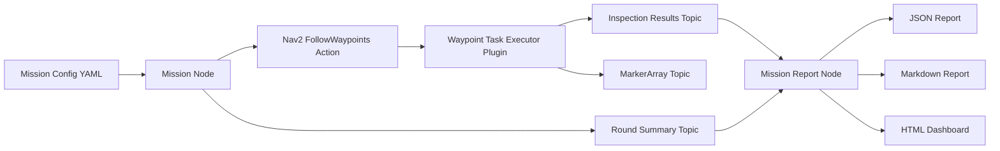

# Project Pitch And Scope

## Elevator Pitch

`Autonomous Factory Inspection Robot` is a ROS 2 and Nav2 mobile robotics project that patrols a factory-like environment, visits configured checkpoints, performs a lightweight inspection task at each stop, saves evidence images, publishes live anomaly markers in RViz, and produces structured mission reports and dashboards.

This is designed as a hireable portfolio project, so the emphasis is not only on making the robot move, but on showing:

- clear system layering
- sound mission design
- repeatable verification
- operator-facing outputs
- engineering reasoning and trade-offs

## Problem Statement

A useful inspection robot is not just a navigation demo. It has to answer:

- Where should the robot go?
- What should happen when it gets there?
- How do we know what happened during the run?
- What should operations do next if something is wrong?

This project answers those questions with a layered architecture.

## Locked Decisions

- Navigation MVP: Nav2 waypoint follower
- Patrol policy: `Option A`, resend one waypoint round at a time
- Implementation language for mission layer: C++
- Checkpoints: stored in YAML config
- Inspection behavior: `stop -> capture -> classify -> save -> continue`
- Anomalies: controlled labels first, not random perception
- Priority: reliable mission execution before advanced perception

## High-Level Architecture

## Layer Responsibilities

### Navigation Layer

- Gets the robot from point A to point B
- Owns path planning, local control, recovery, and waypoint execution
- Implemented with Nav2

### Mission Layer

- Decides when a round starts
- Decides what a patrol round means
- Tracks round completion
- Decides whether to continue, retry, or hold

### Inspection Layer

- Runs at each waypoint arrival
- Captures images
- Assigns a controlled inspection result
- Saves evidence and publishes structured inspection events

### Reporting Layer

- Listens to inspection and round summary topics
- Writes machine-readable and human-readable artifacts
- Supports review after the run

## Phase Plan

### Phase 1

- Bring up simulation
- Patrol configured waypoints
- Detect round completion
- Print terminal summary

### Phase 2

- Stop at each checkpoint
- Capture one image
- Attach a controlled inspection label
- Save evidence

### Phase 3

- Publish live anomaly markers
- Publish structured ROS messages
- Generate JSON, Markdown, and HTML reports

### Phase 4

- Add severity-aware policy
- Add safety decisions such as `HOLD`
- Improve reliability and reproducibility
- Make visual verification dependable

## Current Deliverables

- C++ patrol mission node
- C++ Nav2 waypoint task executor plugin
- Custom ROS message package for inspection and round summary events
- CSV, JSON, Markdown, and HTML outputs
- RViz markers for warning and critical results
- Offline benchmark world assets for reliable visual simulation runs

## Why This Is A Strong Portfolio Project

- It uses core robotics middleware concepts, not just scripts.
- It shows clean separation between navigation, mission logic, perception stub, and reporting.
- It demonstrates verification discipline.
- It produces artifacts a hiring manager can inspect without reading all the code first.
- It gives strong interview material around actions, lifecycle, plugins, QoS, and systems trade-offs.

