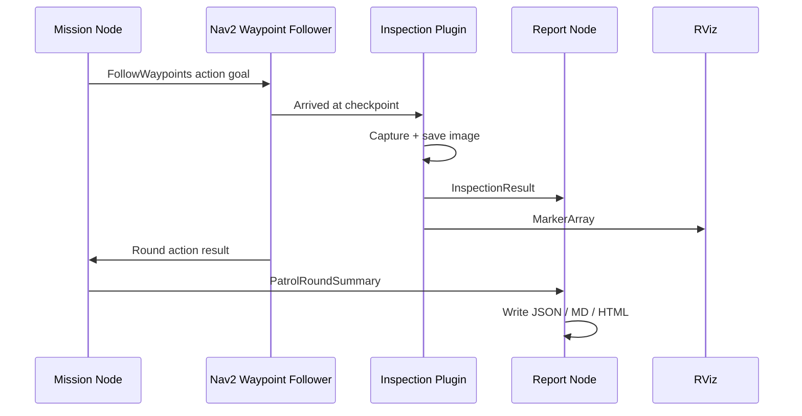

# Phase 3 Reporting And Visualization

## Goal

Make the robot observable both during the run and after the run.

This phase answered two different operator needs:

- live awareness while the robot is moving
- structured evidence after the round finishes

## Major Additions

- custom ROS messages for inspection and round summary events
- live RViz markers for warning and critical states
- event-driven report generation
- JSON, Markdown, and HTML outputs

## Why Custom Messages Were Added

Terminal logs are fine for debugging, but they are a bad contract between software components.

Custom messages made the project cleaner because:

- the inspection layer publishes facts
- the mission layer publishes round outcomes
- the reporter listens and writes artifacts

This is the moment the system became event-driven instead of log-scraping.

## New Interfaces

### `InspectionResult.msg`

Carries:

- checkpoint name
- label
- severity
- recommended action
- anomaly flag
- capture status
- image path
- pose
- note

### `PatrolRoundSummary.msg`

Carries:

- round number
- duration
- Nav2 result
- missed checkpoints
- inspection counts
- severity counts
- mission decision
- decision reason

## Why `MarkerArray` Was Used

Analogy: the CSV is the incident notebook, but the marker is the warning light on the operator console.

Where it fits:

- RViz
- live situational awareness

Why it exists:

- anomalies should be visible on the map immediately
- debugging is faster when the semantic state is spatial

## Reporter Node Role

The reporter node is a separate subscriber-based component that writes:

- `round_0001_report.json`
- `round_0001_report.md`
- `round_0001_report.html`
- `latest_dashboard.html`

Why a separate node is better than embedding file writes in the mission node:

- cleaner separation of concerns
- easier to replace or extend reporting later
- lower risk of mixing control flow with file I/O

## Visual Outputs

### In RViz

- map
- robot
- Nav2 planning state
- warning/critical markers at checkpoint locations

### In Reports

- per-round stats
- checkpoint evidence
- severity labels
- recommended actions
- image thumbnails in HTML dashboard

## Sequence Of Data Flow

## What Was Verified

- `/inspection_markers` displayed warning and critical states in RViz
- round reports were written automatically after round completion
- the HTML dashboard included evidence and mission decision
- the anomaly and warning counts matched the checkpoint configuration

## Why This Phase Matters For A Portfolio

Many robotics demos stop at “the robot moved”. This phase proves:

- telemetry design
- interface design
- operator visibility
- post-run auditability

That makes the project much stronger in interviews.

## Interview Questions For Phase 3

### Why use messages and a report node instead of parsing console output?

- Because logs are not a stable API.
- Because other tools can subscribe to messages.
- Because automation and dashboards become much easier.

### Why is `MarkerArray` useful but not enough as a reporting format?

- Because markers are for live visualization.
- Because reports need durable, queryable, exportable data.
- Because operators need both real-time context and persistent records.

