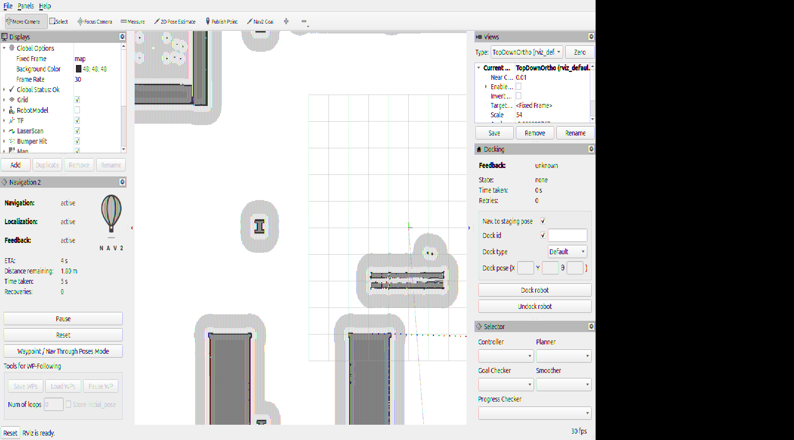
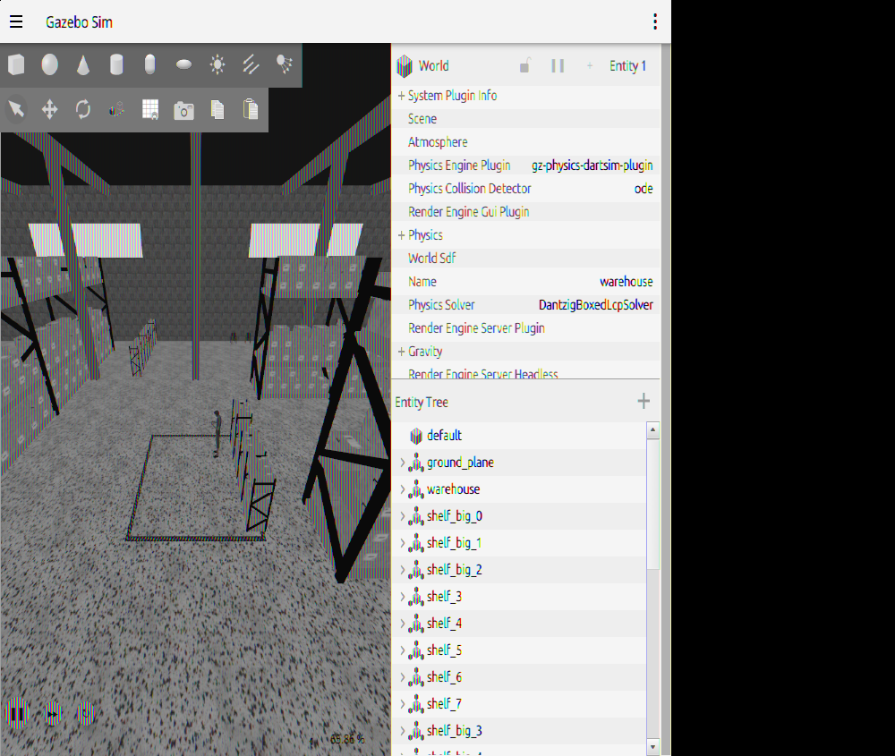
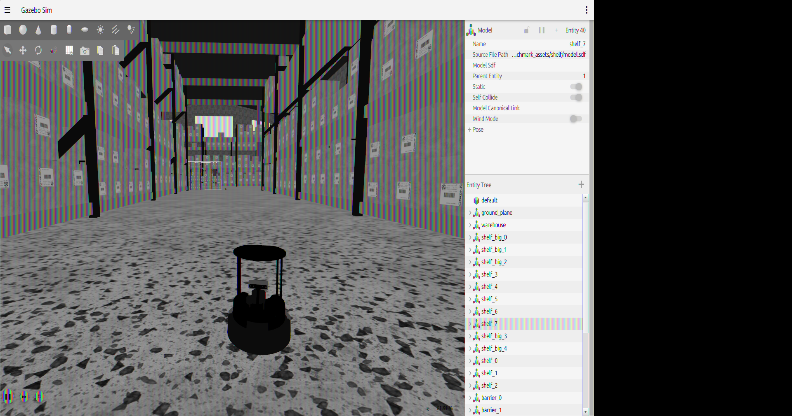
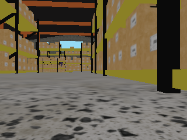
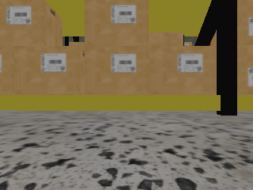

# Results Gallery

## Purpose

This page collects the most useful visual and artifact proof that the project works.

## Visual Benchmark Proof

### RViz During Advanced Benchmark

What this shows:

- RViz running with the benchmark config
- live Nav2 state during the patrol
- the project can run in visualization mode, not only headless

### Gazebo During Advanced Benchmark

What this shows:

- Gazebo simulation running with the benchmark world
- the robot moving in the environment used for patrol verification

### RViz At Hold State

What this run corresponds to:

- critical and warning checkpoints already processed
- round 1 completed
- mission decision moved to `HOLD`

### Gazebo At Hold State

What this shows:

- the visual benchmark remained alive through round completion
- the offline world fix made visual verification reproducible enough to capture

## Checkpoint Evidence

### Critical Checkpoint Image

Source:

- saved benchmark evidence copied from the runtime artifact folder

### Warning Checkpoint Image

Source:

- saved benchmark evidence copied from the runtime artifact folder

## Result Artifacts

- JSON report: [assets/results/round_0001_report.json](assets/results/round_0001_report.json)
- Markdown report: [assets/results/round_0001_report.md](assets/results/round_0001_report.md)
- HTML report: [assets/results/round_0001_report.html](assets/results/round_0001_report.html)
- Latest dashboard: [assets/results/latest_dashboard.html](assets/results/latest_dashboard.html)
- CSV log: [assets/results/inspection_log.csv](assets/results/inspection_log.csv)

## Result Summary

The verified advanced benchmark outcome captured in these artifacts is:

- patrol round completed successfully
- 5 inspections executed
- 2 anomalies recorded
- 1 warning recorded
- 1 critical recorded
- 0 capture failures
- mission decision: `HOLD`

## Why These Artifacts Matter

- screenshots prove the system ran visually
- checkpoint images prove evidence capture worked
- CSV proves structured logging worked
- JSON proves machine-readable reporting worked
- HTML proves operator-facing presentation worked

